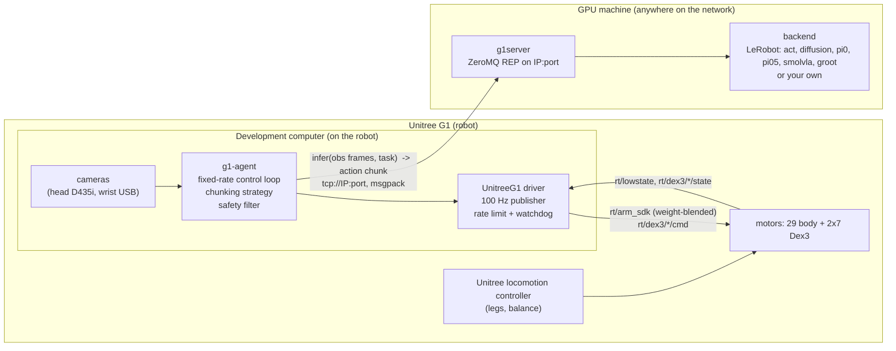

# Architecture

## In one picture

**The agent lives on the robot; the model lives on the GPU machine.** The only thing the robot needs to know is
the server's `IP:port`. Everything model-specific (normalisation, image size, tokenizer, observation history,
chunk length) is on the server side, next to the checkpoint. Everything robot-specific (joint order, limits,
gains, cameras, timing, safety) is on the agent side. The two meet in a small, fixed protocol.

## The Unitree G1 side

| Piece | What it is | Notes |
|---|---|---|
| Robot network | DDS (CycloneDDS) on the robot's internal Ethernet, usually `192.168.123.0/24` | the agent runs on a computer on this network (typically the G1's development computer, e.g. Jetson Orin, often at `.164`) |
| `rt/lowstate` | 500 Hz joint state of all 29 body motors (+ IMU) | read by the driver |
| `rt/arm_sdk` | `LowCmd_` for the upper body, **blended** with Unitree's own controller | `motor_cmd[29].q` = blend weight: 0 = Unitree, 1 = us. Ramped over 2 s both ways. Legs stay with Unitree's locomotion |
| `rt/dex3/{left,right}/cmd`, `/state` | Dex3 three-finger hands, 7 motors each | slot order thumb_0, thumb_1, thumb_2, index_0, index_1, middle_0, middle_1; `mode = id \| 1<<4 \| 1<<7`; no CRC |
| Cameras | head RealSense D435i (and/or wrist USB cameras) on the development computer | read in background threads, latest frame used |
| Joint layout used here | 14 arm joints + 14 hand joints = 28 (optionally + 3 waist = 31) | `g1agent/robot/g1_layout.py`, limits from the G1 URDF |

Why arm_sdk and not low-level control of the whole body: the policies here are manipulation policies (arms and
hands). Balance stays with Unitree's controller, which is the safe default for a first deployment. Whole-body
control (legs from a policy) needs `rt/lowcmd`, a debug-mode switch and a balance policy; it is out of scope.

## The agent (on the robot)

1. **Start-up.** `describe` the model. Check the joint count and order, and that every camera the model wants is
   mapped to a robot camera. Probe the chunk length with one inference if the server does not report it. Measure
   the real inference round trip (not a ping). Choose the chunking strategy (docs/CHUNKING.md).
2. **Loop at the control rate** (the model's training fps). Each tick:
   * read joint state and camera frames, append to the observation history (`n_obs_steps` frames);
   * collect a finished reply, if any; align it to the tick its observation was taken at;
   * start a request if the strategy asks (blocking strategies wait for it in this tick);
   * take the strategy's action for this tick; if there is none, **hold**;
   * Safety: refuse a first action far from the measured posture, clip to joint limits, limit the step per tick;
   * send the target to the driver, which streams it to the motors at 100 Hz, rate-limited (max rad/s) with a
     watchdog that holds the posture if targets stop arriving.
3. **Stop** (duration, Ctrl-C, or a safety stop): hold, then ramp the arm_sdk weight back to 0.

Every tick is logged to `logs/run_<time>.jsonl` (queried, reply round trips, held, target, measured state).

## The server (on the GPU machine)

* `python -m g1server --backend lerobot --ckpt <.../pretrained_model> --port 5555`
* One request at a time (ZeroMQ REP). Stateless: the request carries the observation history, so the server can
  be restarted or the model swapped while the robot holds.
* `LeRobotBackend` loads any LeRobot checkpoint folder (policy, normaliser, tokenizer), resizes images to the
  training size, refills the observation queue for multi-frame policies, and un-normalises every action of the
  chunk. It reports the chunk length `predict_action_chunk` really returns (measured at warm-up).
* Other models: `g1server/backends/custom_template.py`.

## Protocol (tcp://IP:port, ZeroMQ REQ/REP, msgpack with numpy arrays)

| Request | Reply |
|---|---|
| `{"method": "ping"}` | `{"ok": true, "t_server"}` |
| `{"method": "describe"}` | `{"ok": true, "spec": PolicySpec}` |
| `{"method": "reset"}` | `{"ok": true}` |
| `{"method": "infer", "obs": [frame, ...], "task", "request_id"}` | `{"ok": true, "actions": (T, D) float32, "infer_ms", "model"}` |

`frame = {"state": (S,) float32, "images": {name: (H, W, 3) uint8 RGB}, "t": float[, "extra": {feature: array}]}`,
oldest first. `actions[i]` is the absolute joint target for tick `t0 + i`, `t0` = the tick of the newest frame.
Errors come back as `{"ok": false, "error"}`, and the agent treats them as a missing chunk (the robot holds).
No pickle on the wire. `PolicySpec` fields: `g1agent/spec.py`.

## Network and timing

The round trip (network + inference) decides the strategy, not the other way round. Rough guide at 30 Hz
(one period = 33 ms):

| Round trip | What works |
|---|---|
| < 25 ms (wired LAN, small model) | anything, including blocking ACT ensembling |
| 25-70 ms | receding horizon (with a short pause per replan) or async |
| 70-300 ms (Wi-Fi, VLA models) | async only, execute well above the latency |
| > chunk length | stalls: put the server closer, use a faster GPU, or a smaller model |

Use a wired link for the first runs. The agent prints the measured round trip and the strategy it chose.
